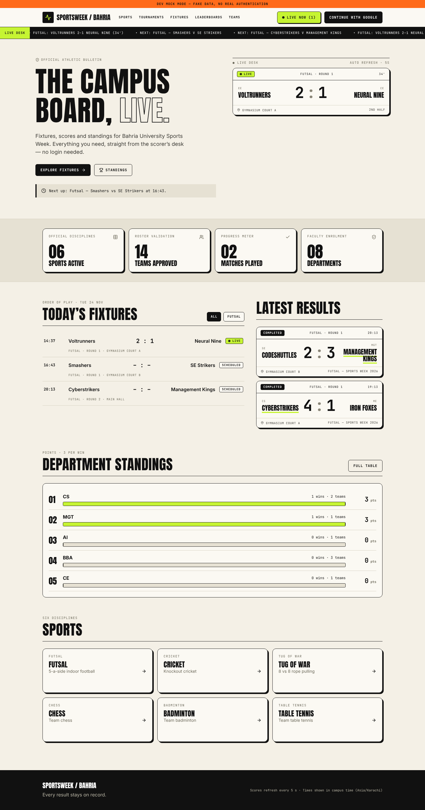
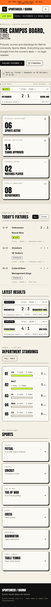
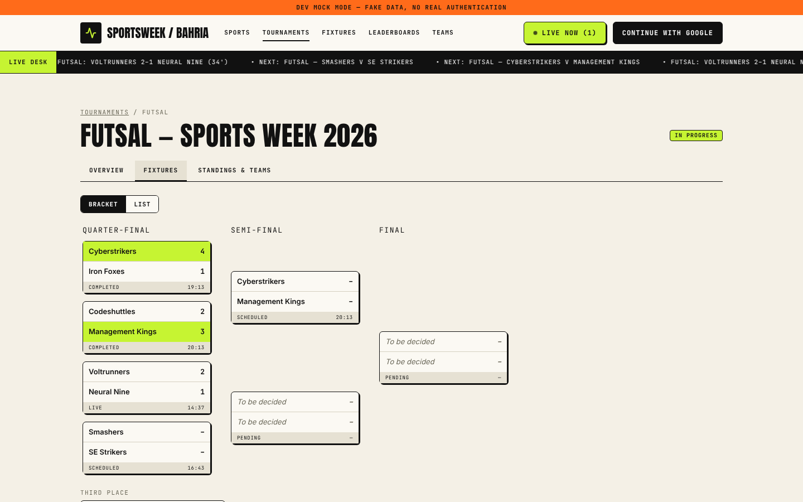
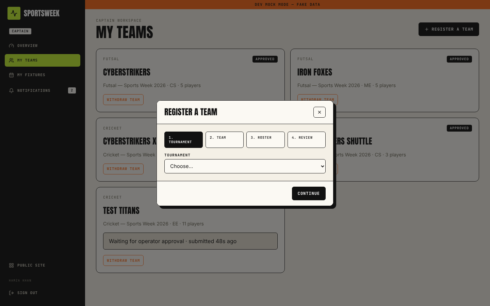
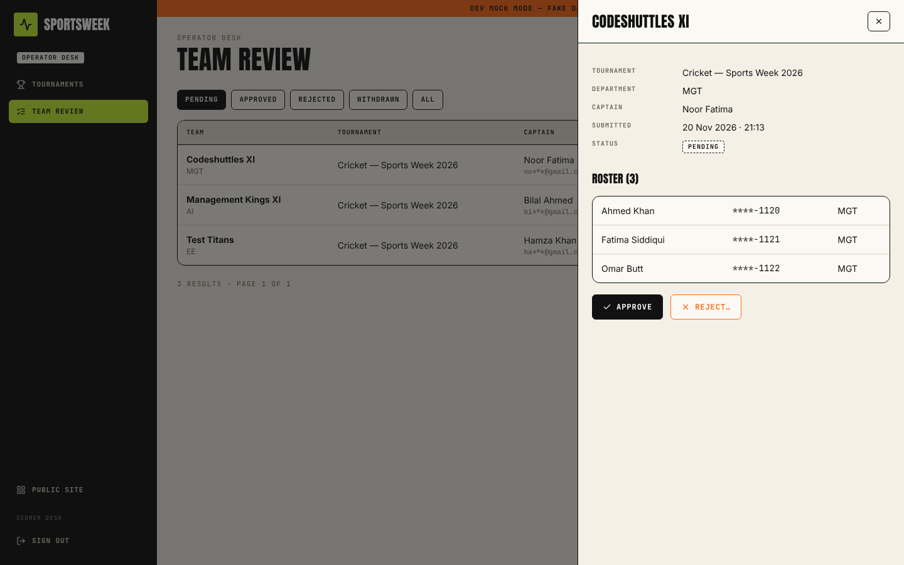
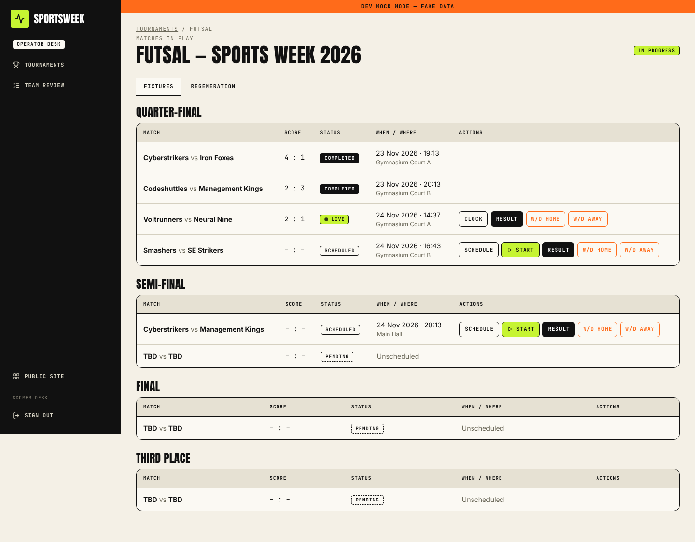
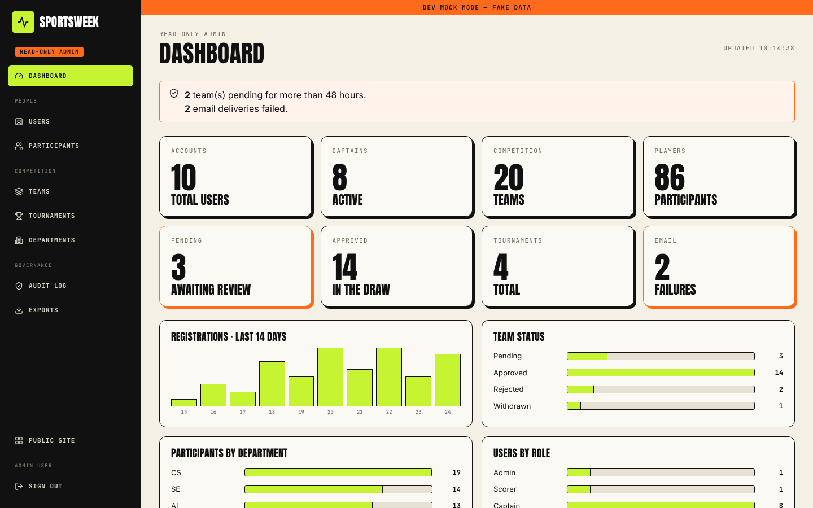
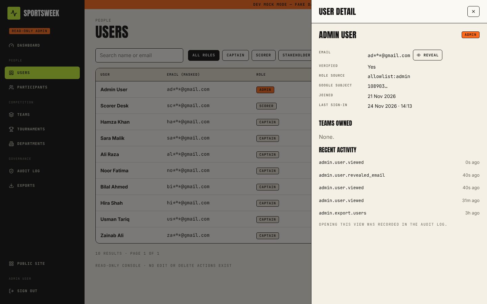

<div align="center">

# 🏆 SportsWeek Manager

**A full-stack tournament management platform for university sports weeks — public live scoreboard, captain workspaces, an operator desk for running the competition, and a read-only admin console.**


[](https://github.com/HAIDU911/sportsweek-manager-2026/actions/workflows/ci.yml)


[Overview](#-overview) · [Screenshots](#-screenshots) · [Features](#-features) · [Architecture](#-architecture) · [Quick start](#-quick-start) · [API](#-api-overview) · [Testing](#-testing) · [Security](#-security-model) · [Roadmap](#-roadmap--honest-status)

</div>

---

## 📖 Overview

**SportsWeek Manager** replaces the spreadsheets, WhatsApp groups and hand-drawn brackets that campus sports weeks usually run on. It covers the whole lifecycle of an inter-departmental tournament: a team registers, an operator approves it, the bracket is drawn and scheduled, scores go live to spectators, and the winner advances automatically — with every action audited.

The design goal throughout is **not trusting the browser**. Roles are assigned server-side from email allowlists, permissions are enforced on every endpoint, public responses are explicit projections served from SQL views that physically do not contain private columns, and the admin console has *no write endpoints at all* by construction.

> Built as a complete reference implementation: layered .NET backend, hardened PostgreSQL schema, typed React frontend, contract checking, database security tests and browser flow tests.

### Highlights

| | |
|---|---|
| ⚡ **Live scoreboard** | Public home page polls every 5 s: live matches with period and clock, today's fixtures, latest results, next up, top standings |
| 🗂 **Deterministic brackets** | Single elimination for 2–64 teams with standard seeding, byes to top seeds, bye chains, walkovers, double forfeits, optional 3rd-place match |
| 🔁 **Continuation regeneration** | Redraw the remaining bracket after withdrawals — history is kept, eliminated teams excluded, no completed pairing is ever replayed |
| 🕒 **Clash-aware scheduling** | Venue double-booking, team overlap and < 30 min turnaround are rejected *before* a fixture is saved |
| 🔐 **Server-assigned roles** | Five roles derived from allowlists + verified email; the token can never escalate them |
| 🕵️ **Privacy by default** | Emails and enrollment numbers masked; revealing them or exporting PII is an audited action requiring a reason |
| 🧾 **Append-only audit** | Triggers block UPDATE/DELETE/TRUNCATE, the API role has no such grant, and the table has no FK so cascades cannot erase it |
| 🧪 **Tested honestly** | 77 backend tests (~2 500 randomized tournament simulations), 11 DB security tests on real PostgreSQL, 23 frontend unit tests, 23 browser flows |

---

## 📸 Screenshots

| Public home (desktop) | Public home (mobile) |
|---|---|
|  |  |

| Tournament bracket | Captain registration |
|---|---|
|  |  |

| Operator desk — review queue | Operator desk — manage tournament |
|---|---|
|  |  |

| Admin console — dashboard | Admin console — users |
|---|---|
|  |  |

---

## ✨ Features

### Public (no login)
- Live scoreboard with auto-refresh, live clock and current period.
- Sports catalogue, tournaments, fixtures feed and per-tournament standings.
- Approved teams and rosters only — pending/rejected teams are never exposed.
- Safe projections only: no emails, no enrollment numbers, no internal ids beyond public ones.

### Captain (Google sign-in, verified email)
- Register a team **idempotently** — `Idempotency-Key` makes retries safe, so a double-tap never creates two teams.
- Roster validation per sport (min/max players), department rules, duplicate checks.
- Withdraw a team with a reason; opponents in unplayed matches advance by walkover.
- Own fixtures and notifications only — scope comes from the token, never from a query parameter (no IDOR).

### Operator desk / Scorer
- Review queue: approve or reject pending teams with a mandatory reason, captain notified.
- Tournament lifecycle: `Draft → Open → Closed → InProgress → Completed`, plus `Cancelled`.
- Generate fixtures, schedule with clash detection, start matches, push live scores, record results.
- Walkovers, double forfeits, abandoned matches and mid-tournament withdrawals.
- Regeneration with **preview → confirm** so destructive redraws are never a surprise.
- Optimistic concurrency (`version`) on every mutation: a stale write is rejected with `409`, not silently applied.

### Admin console (strictly read-only)
- Dashboard: counts, role and department breakdowns, registrations per day.
- User, participant, team and department directories with search and filters.
- Append-only audit viewer and audited, formula-injection-safe CSV exports.
- PII masked by default; reveal requires an explicit action and is itself audited.

---

## 🏗 Architecture

```
Browser (React / Vite — Supabase Auth used for Google sign-in only)
   │  HTTPS JSON + Supabase access token (Bearer)
   ▼
ASP.NET Core 8 API
   │  correlation → exception shield → security headers → CORS
   │  → authentication → rate limit → authorization
   │  JWT: issuer, audience, signature (JWKS ES256/RS256 or legacy HS256), lifetime
   │  Role = f(server allowlists, verified email) — never a token claim
   ▼
Application   use cases · policies · masking · CSV safety · provisioning   (pure, unit-tested)
Domain        bracket engine · advancement · regeneration · clash detection (pure, 2 500 simulations)
   ▼
Infrastructure  Dapper + Npgsql · parameterised SQL only · append-only audit
   ▼
Supabase PostgreSQL   RLS on every table · safe public views · audit triggers · least-privilege role
```

### Layer rules

- `Domain` and `Application` have **zero** package dependencies — no HTTP, SQL, Supabase or SMTP. Business rules are testable in isolation.
- The browser never talks to PostgreSQL with a privileged key. Service-role and DB credentials are server-only.
- Public DTOs are explicit projections served from SQL views that **physically lack** private columns.
- Every mutation validates role → ownership → state → input → idempotency, inside one transaction, then audits.

### Key decisions (ADR summary)

| # | Decision | Why |
|---|---|---|
| 1 | Dapper + hand-written SQL instead of EF Core | Predictable, reviewable queries; every statement runs against real PostgreSQL in CI |
| 2 | Role resolved server-side per request (60 s cache) | Revocation takes effect within a minute; token claims cannot escalate |
| 3 | Unverified email ⇒ never elevated | Prevents allowlist spoofing with unverified addresses |
| 4 | Gmail canonicalisation (dots, `+tag`) | Stops alias bypass of allowlists and duplicate accounts |
| 5 | Audit has **no FK**, protected by triggers | History survives cascades and compromised API credentials |
| 6 | Admin console read-only by construction | No write endpoint exists, so none can be misconfigured |
| 7 | Manual validators in Application | Keeps the layer dependency-free; FluentValidation can wrap DTOs at the edge later |
| 8 | `tenant_id` column reserved but **not** multi-tenant | No isolation tests yet, so it is not claimed |

Deeper write-ups: [`docs/ARCHITECTURE.md`](docs/ARCHITECTURE.md) · [`docs/SECURITY.md`](docs/SECURITY.md) · [`docs/ROADMAP.md`](docs/ROADMAP.md)

---

## 🗃 Repository layout

```
sportsweek-manager/
├── frontend/                 React 18 + TypeScript + Vite app
│   ├── src/lib/              typed API client, auth, TanStack Query hooks, formatting, types
│   ├── src/components/       design-system UI kit, fixtures/bracket, layouts, role guard
│   ├── src/pages/            public · auth · captain · ops · admin
│   ├── dev-mock/             in-memory mock API (same contract as docs/API.md)
│   └── e2e/                  Playwright flows (node e2e/flows.mjs)
├── backend/
│   ├── Domain/               bracket generator/advancer, regeneration, clash detector (pure)
│   ├── Application/          use-case services, policies, masking, role provisioning
│   ├── Contracts/            DTOs shared with the frontend contract test
│   ├── Infrastructure/       Dapper stores and SQL
│   ├── Api/                  Program.cs, endpoints, middleware, auth
│   └── Tests/                77 xUnit tests
├── supabase/
│   ├── migrations/           0001 schema · 0002 audit · 0003 views · 0004 RLS · 0005 api role · 0006 ops/feed
│   ├── seed.sql              demo data (fake, dev only)
│   └── tests/                11 DB security tests + SQL harness
├── docs/                     API · ARCHITECTURE · SECURITY · ROADMAP · screenshots
├── tools/check_contract.py   fails if TS types drift from C# DTOs
└── .github/workflows/ci.yml  5 CI jobs: backend · frontend · contract · database · secrets
```

---

## 🚀 Quick start

### Option A — See the UI in 60 seconds (no database, no sign-in)

The fastest way to explore every screen. Uses an in-memory mock API that speaks the same contract as the real backend.

```bash
cd frontend
npm install

# terminal 1 — mock API on :5000
npm run mock-api

# terminal 2 — UI on :5173 with a role picker
npm run dev:mock
```

Open <http://localhost:5173> and pick **captain**, **scorer** or **admin** from the role switcher. A banner marks mock mode on every page, and the real API never accepts `mock-*` tokens — mock mode cannot leak into production.

> The mock is a UI harness only. Business rules live in the C# backend.

### Option B — Run the real stack

**Prerequisites:** Node 22+, .NET 8 SDK, a Supabase project, a Google Cloud OAuth client.

<details>
<summary><b>1. Supabase</b></summary>

1. Create a project at [supabase.com](https://supabase.com).
2. **Authentication → Providers → Google**: enable it and add the redirect URL
   `http://localhost:5173/auth/callback` (plus your production URL later).
3. Open `supabase/migrations/0005_api_role.sql` and **change the password** before applying.
4. Apply migrations `0001` → `0006` in order (SQL editor, or `supabase db push`).
5. Optional demo data: run `supabase/seed.sql`.

</details>

<details>
<summary><b>2. Backend</b></summary>

```bash
cp .env.example .env          # fill in the values below, then export them
cd backend
dotnet restore
dotnet test Tests
dotnet run --project Api      # http://localhost:5000
curl http://localhost:5000/health/ready
```

Environment variables the API needs:

| Variable | Purpose |
|---|---|
| `Supabase__Url` | Project URL (used to fetch JWKS) |
| `Supabase__Audience` | Expected JWT audience (`authenticated`) |
| `Supabase__JwtSecret` | **Only** for legacy HS256 projects — leave empty for JWKS |
| `ConnectionStrings__Supabase` | PostgreSQL connection string using the `sportsweek_api` role |
| `Cors__Origins__0` | Frontend origin, e.g. `http://localhost:5173` |
| `Auth__AllowedDomains__0` | Permitted email domains (e.g. `gmail.com`, `bahria.edu.pk`) |
| `Auth__Admins__0` | Emails granted the read-only **Admin** role |
| `Auth__Scorers__0` | Emails granted the **Scorer** (operator desk) role |

Swagger UI is available at `/swagger` in Development only.

</details>

<details>
<summary><b>3. Frontend</b></summary>

```bash
cd frontend
cp .env.example .env.local
npm install
npm run dev                   # http://localhost:5173
```

```dotenv
VITE_API_BASE_URL=http://localhost:5000
VITE_SUPABASE_URL=https://your-project-ref.supabase.co
VITE_SUPABASE_ANON_KEY=your-anon-key
VITE_AUTH_MODE=supabase
```

Only the **anon** key belongs in the browser. Sign in with Google — the workspace you land in (public / captain / operator desk / admin console) reflects the role the server assigns you.

</details>

### Roles at a glance

| Role | Assigned by | Can do |
|---|---|---|
| **Public** | — | Watch live scores, fixtures, brackets, standings, approved team names |
| **Captain** | Any verified email | Register/withdraw own teams, see own fixtures and notifications |
| **Scorer** | `Auth__Scorers__n` allowlist | Everything operational: review teams, draw brackets, schedule, score, regenerate |
| **Admin** | `Auth__Admins__n` allowlist | **Read-only**: dashboard, users, participants, audit log, audited CSV exports |
| **Stakeholder** | `Auth__Stakeholders__n` allowlist | Reserved — currently lands on the public site |

Roles come **only** from server allowlists plus a verified email. The browser can never choose one.

---

## 🔌 API overview

Base URL `http://localhost:5000` · auth via `Authorization: Bearer <Supabase access token>`.

Errors always use one shape — `{ code, message, fieldErrors, correlationId }` — and every response carries `X-Correlation-Id`.

| Status | Meaning |
|---|---|
| 400 | Validation failure (see `fieldErrors`) |
| 401 | Missing, invalid or expired token |
| 403 | Wrong role, unverified account, or disallowed domain |
| 404 | Not found |
| 409 | Conflict — duplicate team/player, team limit, stale `version`, schedule clash |
| 422 | Business rule / domain invariant violated |
| 429 | Rate limited (`Retry-After`) |
| 503 | Dependency (database) unavailable |

<details>
<summary><b>Endpoint groups</b></summary>

| Group | Examples | Access |
|---|---|---|
| **Health** | `GET /health` · `GET /health/ready` | public |
| **Public** | `/api/public/home` · `/sports` · `/tournaments` · `/fixtures` · `/teams` · `/leaderboards/overall` · `/tournaments/{id}/standings` | no login, 120 req/min/IP, cached 15 s (home 5 s) |
| **Identity** | `GET /api/me` — profile + **server-assigned** role | any signed-in user |
| **Captain** | `GET/POST /api/captain/tournaments/{id}/teams` (idempotency key) · `/teams/{id}/withdraw` · `/notifications` · `/fixtures` | Captain |
| **Operator desk** | `/api/ops/tournaments` · `/teams/{id}/review` · `/fixtures/generate` · `/fixtures/{id}/schedule` · `/start` · `/live` · `/result` · `/regeneration/preview` · `/confirm` | **Scorer only** |
| **Admin (read-only)** | `/api/admin/dashboard` · `/users` · `/participants` · `/teams` · `/departments` · `/audit` · `POST /exports/users` · `POST /exports/participants` | Admin |

Full request/response documentation: [`docs/API.md`](docs/API.md).

</details>

---

## 🧪 Testing

```bash
# Backend — domain engine, application services, security, ops desk
cd backend && dotnet test Tests

# Frontend — type-check, unit tests, production build
cd frontend && npm run typecheck && npm test && npm run build

# Frontend ↔ backend contract (28 DTOs, 0 drift required)
python3 tools/check_contract.py

# Database — migrations + 11 security tests against real PostgreSQL
psql -f supabase/tests/security_tests.sql

# Browser flows (with the mock API + dev:mock running)
node e2e/flows.mjs
```

### What the tests actually cover

| Check | Result |
|---|---|
| Backend unit tests (engine incl. ~2 500 randomized tournaments, security, admin, captain, identity, operator desk) | ✅ 77 pass\* |
| Database: 6 migrations, 11 security tests, every query executed on PostgreSQL 16, least-privilege role | ✅ |
| Frontend: type-check, production build (~153 kB gzip JS), 23 unit tests | ✅ |
| Browser: 23 end-to-end flows (register, review, clash, tie, masked PII, reveal, export, role isolation) + screenshots of 18 views, zero console errors | ✅ against the dev mock API |
| Frontend ↔ backend contract: 28 DTOs compared | ✅ 0 drift |
| `Api` + `Infrastructure` C# | ⚠ compiled against API-shaped stubs of Dapper/Npgsql/JwtBearer — the first real `dotnet build` may need small fixes |
| Real Google/Supabase login, real API ↔ real browser, email, load test, pen test | ❌ not done |

\* run with a local xUnit stand-in (NuGet was unreachable in the original build sandbox); the tests use standard xUnit attributes and are CI-ready.

---

## 🔐 Security model

| Threat | Control |
|---|---|
| Forged / expired token | Issuer, audience, signature, lifetime validated; only ES256/RS256/HS256; JWKS cache with rotation |
| Role escalation via token or body | Role comes from the DB profile ← server allowlists; the browser's role is ignored |
| Allowlist spoofing with unverified email | Unverified ⇒ Captain only, cannot register teams |
| Gmail alias bypass | Dots and `+tags` canonicalised before allowlist checks |
| IDOR on captain data | Scope = caller id from the token; there is no id parameter to tamper with |
| PII over-exposure | Masked by default; reveal and sensitive export need an explicit action + reason and are audited |
| CSV formula injection | `'` prefix on `= + - @ \t \r` |
| SQL injection | Parameters only; LIKE wildcards escaped; all statements run on PostgreSQL in CI |
| Duplicate / racing registration | DB unique constraints + row lock + idempotency key |
| Audit tampering | Triggers block UPDATE/DELETE/TRUNCATE; API role has no grant; no FK so cascades cannot erase it |
| Leaked anon key | RLS on every table, no anon policies on base tables, public views omit private columns |
| Abuse / scraping | Public 120/min/IP, authenticated 240/min, exports 5 per 10 min |
| Clickjacking / sniffing / caching | CSP `default-src 'none'`, X-Frame-Options, nosniff, HSTS, `no-store` on private routes |

Full threat register and pre-production checklist: [`docs/SECURITY.md`](docs/SECURITY.md).

> ⚠️ **This is not production-ready yet.** The gaps are listed honestly in [`docs/ROADMAP.md`](docs/ROADMAP.md) — chiefly the first real `dotnet build`, a real Google login round-trip, email delivery, and load/pen tests.

---

## 🗺 Roadmap & honest status

| Phase | Scope | Status |
|---|---|---|
| 0 | Decisions, read-only admin scope, design prompt pack | ✅ |
| 1 | Solution structure, strict compiler settings, health checks, CI | ✅ (CI not yet run on GitHub) |
| 2 | Domain engine — brackets, advancement, regeneration, clashes | ✅ 62 tests incl. ~2 500 simulations |
| 3 | Identity — JWT validation, server-assigned roles | ✅ code + unit tests · ⚠ not tested against real Supabase/Google |
| 4 | Public + captain API (registration, notifications, withdraw) | ✅ |
| 5 | Admin read-only console API | ✅ |
| 5b | Operator desk — review, lifecycle, generation, scheduling, live scoring | ✅ 15 service tests + SQL verified on PostgreSQL |
| 6 | Frontend — 4 shells, 30+ routes, design system, bracket, role guards | ✅ builds, 23 unit tests, 23 browser flows (mock API) |
| 7 | Email outbox worker, Realtime push, metrics | ⏳ |
| 8 | Load test (300 users), pen test, restore drill, sign-off | ⏳ |

Known gaps next up: first real `dotnet build` of `Api`/`Infrastructure`, first real Google login, in-app → email notifications, manual seed editing, multi-day venue schedule view, per-sport scoring detail (sets/innings), tiebreak rules for draw-valid sports (e.g. chess), and a Playwright run against the real stack in CI.

---

## 🤝 Contributing

```bash
git checkout -b feat/short-description
# keep Domain/Application dependency-free; add a unit test for engine changes
npm run typecheck && npm test && npm run build --prefix frontend
dotnet test backend/Tests
python3 tools/check_contract.py     # must report 0 drift
```

- Changing a DTO? Update `backend/Contracts/Dtos.cs` **and** `frontend/src/lib/types.ts` in the same commit — CI fails otherwise.
- Changing the schema? Add a **new** numbered migration; never edit an applied one.
- Never commit `.env`, keys, service-role tokens or database credentials. Copy `.env.example` instead.

---

## 📚 Documentation

| Document | Contents |
|---|---|
| [`docs/API.md`](docs/API.md) | Every endpoint, request shape, business rule and status code |
| [`docs/ARCHITECTURE.md`](docs/ARCHITECTURE.md) | Diagram, layer rules, ADR summary, tournament engine behaviour |
| [`docs/SECURITY.md`](docs/SECURITY.md) | Threat register, evidence per control, pre-production checklist |
| [`docs/ROADMAP.md`](docs/ROADMAP.md) | Phase-by-phase status and known gaps |
| [`docs/STITCH_FRONTEND_PROMPT.md`](docs/STITCH_FRONTEND_PROMPT.md) | Design-system prompt pack used to generate the UI |
| [`frontend/README.md`](frontend/README.md) | Frontend routes, structure and mock mode |

---

<div align="center">
<sub>Built for Bahria University Sports Week · React + .NET 8 + Supabase PostgreSQL</sub>
</div>
